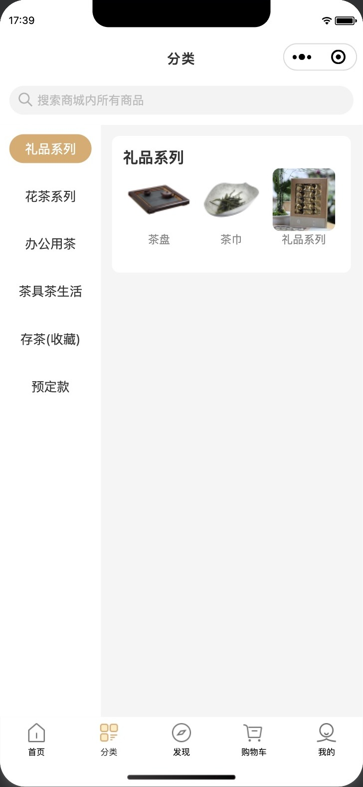
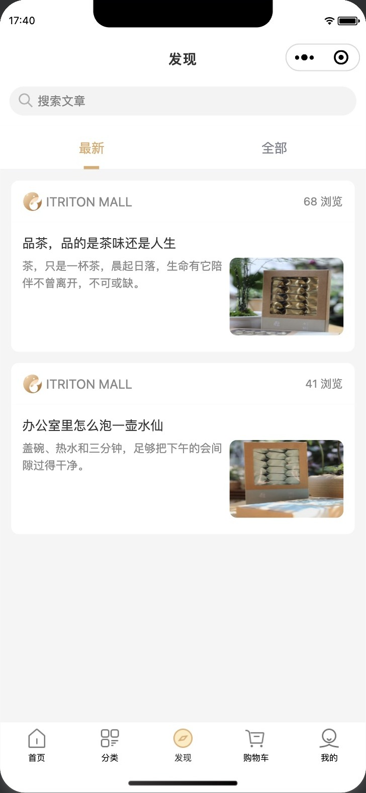
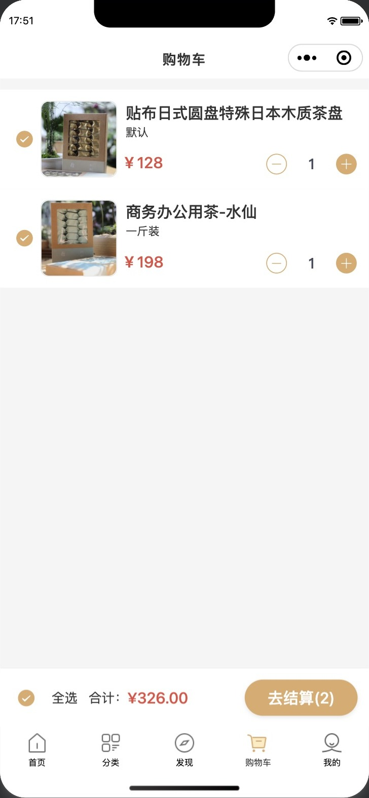

# ITRITON MALL

[](https://gitee.com/ibaleine-open-source/ibaleine-weapp/stargazers)
[](https://gitee.com/ibaleine-open-source/ibaleine-weapp/members)

[](https://github.com/icjs-cc/ibaleine-weapp/stargazers)
[](https://github.com/icjs-cc/ibaleine-weapp/network)

## 介绍
基于原生小程序框架的商城项目

## 目录说明
```
pages                 主包页面（首页 / 分类 / 发现 / 购物车 / 我的）
pagesAuthority        登录、切换账号、修改密码
pagesGoods            商品详情，以及仅详情使用的规格组件
pagesOrder            确认订单、优惠券，以及优惠券组件
pagesMine             地址、设置、公告、关于
component             通用组件
itriton               组件库（t-组件名）
styles                公共样式
utils                 请求、路由、存储和工具方法
mock                  本地 mock
```

## 本地运行
使用微信开发者工具导入本仓库，AppID 可先用测试号。`utils/config.js` 里 `is_mock` 为 `true` 时走本地数据，接真实接口时改为 `false`，并填写 `dev` / `pro` 的接口地址。

## 项目截图
 
 
 
 
 

## 开发者信息
微信号：icjs（福建 厦门）

 

## 其他线上项目

