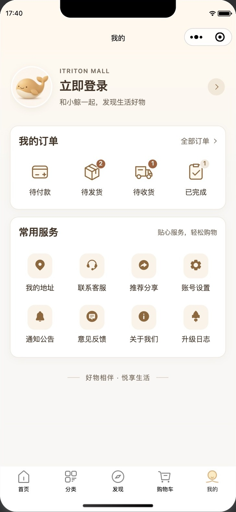
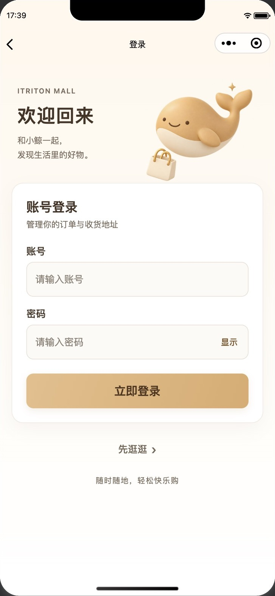

# ITRITON MALL

[](https://gitee.com/ibaleine-open-source/ibaleine-weapp/stargazers)
[](https://gitee.com/ibaleine-open-source/ibaleine-weapp/members)
[](https://github.com/icjs-cc/ibaleine-weapp/stargazers)
[](https://github.com/icjs-cc/ibaleine-weapp/network)

原生微信小程序商城。首页、分类、发现、购物车、我的都在主包，商品、订单、账号和个人中心按分包加载。默认使用本地数据，打开就能走通浏览、加购、下单和订单处理。

## 功能

- 首页：轮播、分类入口、商品推荐、搜索
- 分类：按系列查看商品，进入商品列表和详情
- 发现：文章列表、搜索和文章详情
- 商品：规格选择、加入购物车、立即购买
- 购物车：勾选、改数量、结算
- 订单：待付款、待发货、待收货、已完成；支持支付、取消订单、确认收货、申请退货
- 我的：地址、公告、账号设置、关于我们、更新日志
- 账号：登录、切换账号、修改密码

联系客服、推荐分享、意见反馈使用微信提供的按钮能力，需要在小程序后台开通后才会生效。

## 本地运行

1. 安装并打开[微信开发者工具](https://developers.weixin.qq.com/miniprogram/dev/devtools/download.html)。
2. 导入本仓库。没有正式 AppID 时，选用测试号即可。
3. 基础库建议使用 `2.17.0` 或更高版本。
4. 编译后从首页开始预览。

`utils/config.js` 里 `is_mock` 为 `true` 时，请求走本地 mock，购物车和订单保存在本地存储。接入接口时改为 `false`，并填写 `dev` 或 `pro` 的 `url`。`dev_env` 用来选择当前环境。

本地存储的键名带有 `project_en` 前缀。修改这个字段后，需要重新登录，购物车和订单也会按新键重新开始。

## 目录

```
pages                 首页、分类、发现、购物车、我的
pagesAuthority        登录、切换账号、修改密码
pagesGoods            商品列表、商品详情、规格组件
pagesOrder            订单列表、订单详情、确认订单、优惠券
pagesDiscover         文章详情
pagesMine             地址、设置、公告、关于、更新日志
component             通用组件
itriton               组件库，页面里以 t- 开头使用
styles                公共样式
utils                 配置、请求、路由、存储和商品订单数据
mock                  本地 mock
screenshot            项目截图，不打进小程序包
```

颜色、字号、圆角和页面间距定义在 `app.wxss` 的 `page` 变量上，改这里即可统一外观。

## 项目截图

<table>
  <tr>
    <td width="50%" align="center"><b>首页</b><br><br></td>
    <td width="50%" align="center"><b>分类</b><br><br></td>
  </tr>
  <tr>
    <td width="50%" align="center"><b>发现</b><br><br></td>
    <td width="50%" align="center"><b>购物车</b><br><br></td>
  </tr>
  <tr>
    <td width="50%" align="center"><b>我的</b><br><br></td>
    <td width="50%" align="center"><b>登录</b><br><br></td>
  </tr>
</table>

## 开发者


